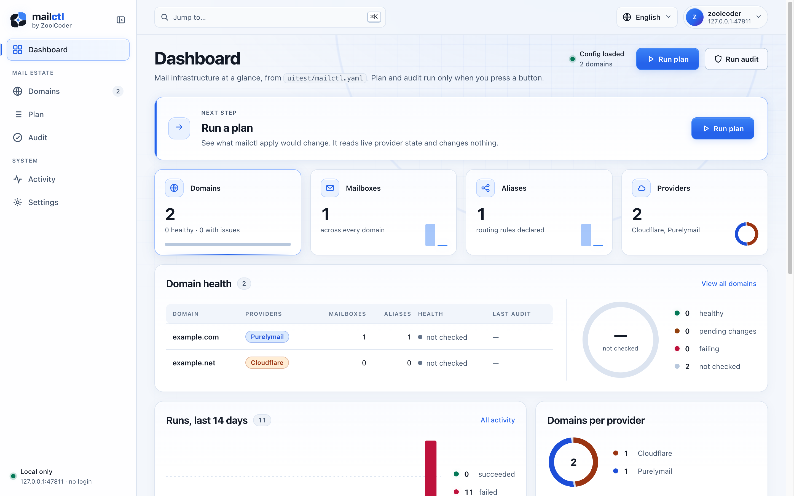
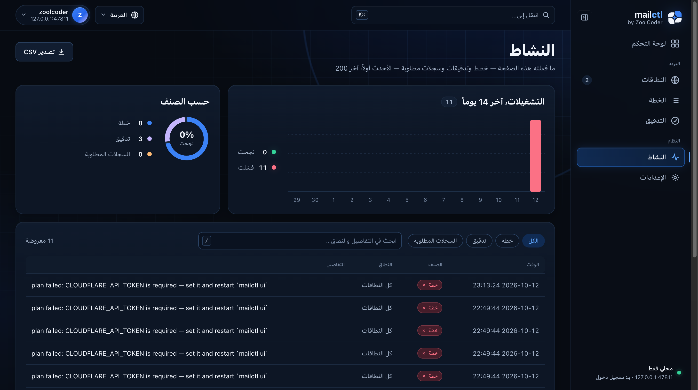

# toolshell

[](https://github.com/zoolcoder/toolshell/actions/workflows/ci.yml)
[](https://pkg.go.dev/github.com/zoolcoder/toolshell)
[](LICENSE)

An admin shell for server-rendered Go apps. Your app brings its pages and its
nav. toolshell brings everything around them: the sidebar, the header, the
stylesheet, one script, the charts and the error pages. It has no
dependencies outside the standard library and needs no build step.

| Light, English | Dark, Arabic (right to left) |
|---|---|
|  |  |

## Features

- **Layout.** A sidebar that folds to icons and slides in on phones, and a
  header with a profile menu and a language menu.
- **Navigation.** A Ctrl/Cmd-K command palette and `g` then key jumps.
- **Languages.** Pages translate with `{{.T "text"}}`, and a language written
  right to left turns the whole layout.
- **Feedback.** Tooltips and toasts. A blocking veil covers the page while a
  long form runs, and confirm dialogs guard dangerous buttons.
- **Data.** Sortable, searchable and paged tables, with CSV export that is
  guarded against spreadsheet formulas.
- **Charts.** Server-rendered SVG: `spark`, `donut`, `cols`, `ring`, `meter`
  and `bars`. They need no JavaScript.
- **Themes.** Light, dark and auto. The choice lives in a cookie, so the
  first paint is already right.
- **Error pages.** Styled pages for 404, 500 and any other status the app
  cannot serve.
- **Security.** A strict Content-Security-Policy with no `'unsafe-inline'`.
  Every asset is a file under `/_ts/`.

## Install

```sh
go get github.com/zoolcoder/toolshell@latest
```

toolshell requires Go 1.26 or later.

## Usage

```go
ts := toolshell.New(toolshell.Config{
	Brand:  toolshell.Brand{Name: "mail", Accent: "ctl"},
	Cookie: "mailctl",
	User:   toolshell.User{Name: "you"},
	Langs: []toolshell.Lang{
		{Code: "en", Name: "English"},
		{Code: "ar", Name: "العربية", Dir: "rtl"},
	},
	Messages: map[string]map[string]string{
		"ar": {"Domains": "النطاقات", "%d domains": "%d نطاقات"},
	},
})

tmpl, err := ts.Templates(appFS, "templates/*.html", funcs)
if err != nil {
	log.Fatal(err)
}
mux := http.NewServeMux()
ts.Mount(mux)

nav := []toolshell.NavGroup{{Items: []toolshell.NavItem{
	{Key: "domains", Label: "Domains", Href: "/domains", Icon: "globe"},
}}}

mux.HandleFunc("GET /domains", func(w http.ResponseWriter, r *http.Request) {
	page := struct {
		toolshell.Chrome
		Count int
	}{ts.Chrome(r, "domains", nav), 3}
	toolshell.Render(w, tmpl, http.StatusOK, "domains.html", page)
})
```

Each page template starts and ends with the shell:

```html
{{template "ts-top" .}}
<h1 class="pg">{{.T "Domains"}}</h1>
<p>{{.T "%d domains" .Count}}</p>
<div class="dial sm">{{donut "ok bad" (ints 7 2)}}</div>
{{template "ts-bottom" .}}
```

The [package documentation](https://pkg.go.dev/github.com/zoolcoder/toolshell)
covers every type and template function.

`Render` executes the page into a buffer before it writes anything. A
template error therefore becomes the styled 500 page, never half a page.
Write `ErrorPage` for any other status.

### Translations

- `{{.T "English text" args...}}` looks the text up in the page's language,
  then formats it.
- `{{.TH ...}}` does the same for a sentence that carries markup. The
  translation is escaped and only the arguments are trusted.
- The shell ships its own Arabic for its menus and dialogs. Strings the app
  supplies win over them.
- The chosen language is kept in the `<cookie>-lang` cookie.
- `GET /lang?set=ar&back=/path` switches the language. `back` is kept on
  this site.

In a right-to-left page, add `class="flip"` around an icon that points
forward, such as a "next" arrow, and `class="back"` around one that points
back. The icon mirrors only where it needs to.

### Content-Security-Policy

`SetHeaders` sets the policy and the other strict headers that every page is
meant to carry. Call it from a middleware, or at the top of each handler. The
policy allows only the page's own origin. Keep inline `<script>` and `style=""` out of your
templates: put behaviour in `data-` attributes the shell's script already
reads, and put styles in classes.

## Packages for CLI tools

Three subpackages hold the plumbing a local admin tool needs besides its
pages. They need nothing beyond the standard library.

- **`guard`** keeps the page on this machine. `ListenAndServe` refuses a
  non-loopback address, then serves with timeouts and a graceful shutdown.
  `Handler` refuses a foreign `Host` (DNS rebinding) and a write started by
  another site (CSRF), sets the headers and caps the body.
- **`mcp`** is a stdio MCP server whose tools are the CLI's own commands, run
  in-process with an empty stdin. A `Plan` tool saves its plan and answers
  with a `plan_id`; an `Apply` tool takes only that id. `Skills` serves an
  embedded `skills/*/SKILL.md` tree as prompts.
- **`doctor`** is the `doctor` report: ok, warn or fail per check, as text or
  as versioned JSON.
- **`activity`** is the JSONL log of what the tool did, for its Activity page.

`toolshell.Back` answers a form post: it redirects to the form's `return_to`
with the outcome as the flash the next page shows.

```go
err := guard.ListenAndServe(ctx, "127.0.0.1:0", handler, func(host string) {
	fmt.Printf("ui on http://%s/\n", host)
})
```

## Used by

- [mailctl](https://github.com/zoolcoder/mailctl): declarative mail domains,
  and its local `mailctl ui` admin page.

## Contributing

See [CONTRIBUTING.md](CONTRIBUTING.md). Report security issues privately, as
described in [SECURITY.md](SECURITY.md).

## License

[MIT](LICENSE)
